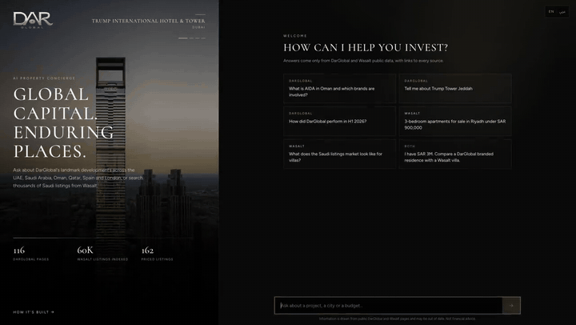
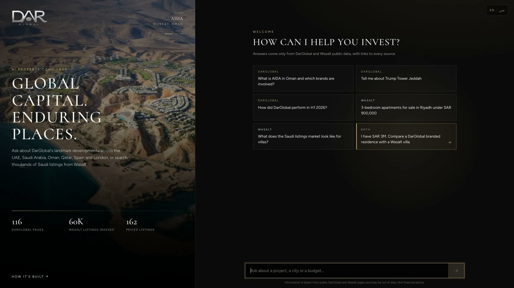

<div align="center">

# DarGlobal Property Concierge

**A tool-using AI agent that answers property questions from cited public sources, and says so when it does not know.**




**[Live demo →](https://darglobal-concierge.onrender.com)** &nbsp;·&nbsp; **[Case study on the portfolio →](https://shahzeb-naeem.vercel.app/en/work/darglobal-property-concierge)**

</div>

> Built end to end in a day by [Shahzeb Naeem](https://github.com/snaeemm). An independent prototype built from public information. It is not affiliated with or endorsed by DarGlobal or Wasalt; names and trademarks belong to their owners. **The scraped data and brand images are not included in this repository**, see [`backend/data/README.md`](backend/data/README.md) to rebuild the data.



## What it does

- **DarGlobal questions:** projects (AIDA, Trump Tower Jeddah, Trump International Hotel & Tower Dubai, DaVinci Tower by Pagani, Les Vagues, Marea…), brand partners, press releases, results, investor information, contact details.
- **Wasalt property search:** "3-bed apartments in Riyadh under SAR 900k" returns real listings as cards, each with price, size, district, Wasalt's own valuation range and a link to the listing.
- **Market questions:** counts by property type, bedroom mix, typical sizes and price ranges, drawn from Wasalt's full public index of 60,000 listings.
- **Mixed questions** that need both sources, e.g. comparing a DarGlobal branded residence with a Wasalt villa.
- Every answer links to its sources, streams word by word, and shows which lookups the assistant made.

## How I built it

### 1. Collecting the data
| Source | Method | Result |
|---|---|---|
| darglobal.co.uk | Crawled every internal link from the home page in a real browser session (the site sits behind an Imperva bot wall that blocks plain HTTP clients), with a delay between requests | 135 pages, 116 with real content |
| Wasalt sitemaps | Wasalt's `robots.txt` allows crawling and publishes sitemaps on its CDN. I parsed the sale, rental and category sitemaps | 60,000 listings (type, size, bedrooms, sale/rent, date) and 8,584 city/district market pages |
| Wasalt listing details | Live listing pages sit behind a Cloudflare human check. Rather than try to defeat it, I used **public Internet Archive snapshots** of the same pages, which carry the full listing data (price, rooms, area, district, amenities, Wasalt's valuation) | Detailed listings and project pages, latest snapshot per listing |

Scripts: `scraper/parse_wasalt_sitemaps.py`, `scraper/fetch_wasalt_archive.py`, `scraper/build_corpus.py`.

### 2. Cleaning
- Sentences that repeat across many pages (menus, footers, cookie banners) are removed.
- Pages are split into ~900-character overlapping passages and tagged with source, section and URL.
- From listings I keep only property facts. **Owner names, phone numbers and other personal data are dropped.**

### 3. Retrieval
- **Text:** BM25 keyword search over ~1,000 passages. It is fast, needs no GPU or embedding model, and fits comfortably in a 512 MB free container.
- **Listings:** stored as structured records, so the assistant filters on real fields (city, district, type, budget, bedrooms, area, furnished) rather than guessing from text.

### 4. The agent
The model works as a **tool-using agent** with three tools:

| Tool | Used for |
|---|---|
| `search_knowledge` | DarGlobal and Wasalt page content |
| `search_listings` | filtering Wasalt listings, plus a price summary |
| `market_overview` | market-level counts and price ranges |

The model decides which tools to call, can chain several (up to 4 rounds), and is instructed to answer **only** from tool results, cite links, and say plainly when the data doesn't cover something.

**Model:** `nvidia/nemotron-3.5-super-vl:free` via OpenRouter, chosen after testing several free models on tool calling (it was the fastest with correct arguments). If it is rate-limited, the backend falls back automatically to `nemotron-3.5-lightning`, `ling-3.2-flash` and `gemma-4-31b`.

### 5. Application
- **Backend:** FastAPI. `/api/chat` streams Server-Sent Events (tokens, tool steps, listing cards, sources). It also has per-IP rate limiting and input validation, and API docs at `/api/docs`.
- **Frontend:** React and Vite, styled to DarGlobal's brand: black and bronze palette, uppercase display serif headings, their logo and favicon. Responsive down to phone width.

### 6. Docker and deployment
- A multi-stage `Dockerfile` builds the React app, then copies it into a slim Python image. **One container serves both the API and the site**, so there's a single URL and no CORS. It runs as a non-root user with a health check. Image ≈ 366 MB, memory ≈ 100 MB.
- Deployed on **Render** (free Docker web service) from GitHub via `render.yaml`. The OpenRouter key lives only in Render's secret environment variables.

```bash
# run locally
docker build -t darglobal-concierge .
docker run -p 8000:8000 -e OPENROUTER_API_KEY=sk-or-... darglobal-concierge
# open http://localhost:8000
```

## Limitations and what I'd do next
- **Wasalt data is a snapshot**, not live. In production I'd ask Wasalt for a partner feed or API instead of scraping.
- **Keyword search** can miss paraphrases. Next steps would be hybrid search (BM25 plus embeddings) and a re-ranker.
- **Free models** can be slow or rate-limited at peak times. Fallbacks reduce this; a paid model would remove it.
- **Free hosting sleeps** when idle. A paid instance or a keep-alive ping fixes this.
- Further additions: evaluation set and answer-quality tests, conversation analytics, lead capture ("register interest") handed to the sales CRM, full Arabic UI.
